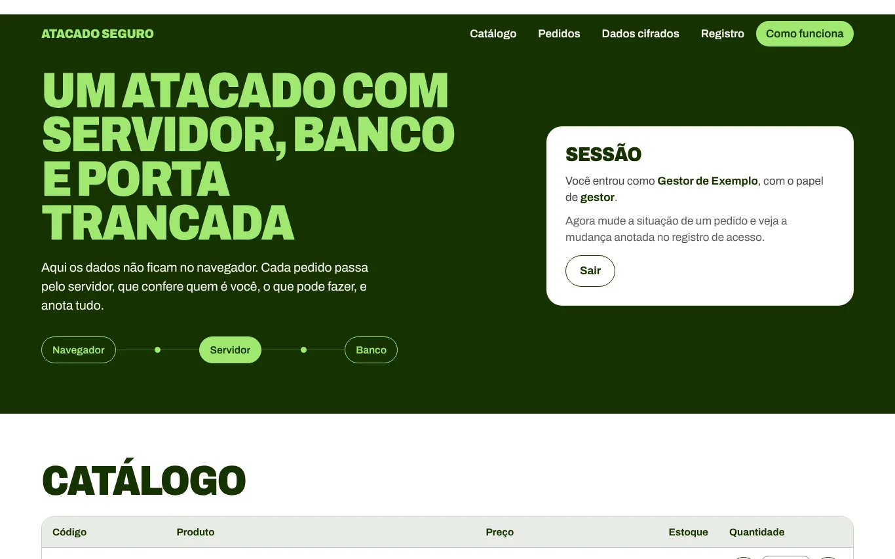

# Atacado Seguro



Demonstração de um sistema de atacado com servidor de verdade, em Cloudflare Workers e banco D1. Empresa, produtos e dados são fictícios. As contas de teste são públicas e estão na própria página.

## O que ele mostra

| Requisito | Como foi feito |
| --- | --- |
| Banco com acesso restrito | O navegador só fala com a API, e o banco só é alcançado pelo Worker, com consultas parametrizadas |
| Login | Sessão em cookie `__Host-`, HttpOnly, Secure e SameSite=Strict, com hash do token no banco |
| Senhas | PBKDF2-SHA-256 com salt e pimenta (HMAC com segredo fora do banco) |
| Permissões | Cliente e gestor conferidos no servidor em cada rota, com proteção contra CSRF e checagem de Origin |
| Criptografia de campos | AES-256-GCM, com o campo e o usuário como dados autenticados |
| Registro de acesso | Logins, negativas e mudanças, sem senhas e com o IP em hash, por 30 dias |
| Cópia de segurança | Time Travel do D1 e `scripts/backup.sh` para exportar |
| Cabeçalhos | HSTS, CSP, `frame-ancestors`, X-Frame-Options e outros em `public/_headers` e na API |

## Limitações conhecidas

- A Web Crypto dos Workers em produção aceita até 100.000 rodadas de PBKDF2, abaixo das 600.000 recomendadas pela OWASP. A pimenta compensa em parte, se só o banco vazar. Para senhas de clientes reais, avalie Argon2id ou um serviço de login gerenciado.
- O plano gratuito limita o tempo de CPU por requisição, e o login pode exceder esse limite. Um sistema real deve usar o plano pago.
- As contas de demonstração têm senhas públicas. Não reutilize este arquivo de contas.
- Não houve teste de invasão independente.

## Como rodar

```sh
npm install
# crie .dev.vars com PIMENTA e CHAVE_DADOS, cada uma com 32 bytes em base64
npm run banco:local
npm run dev
```

Testes: com o servidor local no ar, `BASE=http://localhost:8787 npm run testar`. Precisam de Playwright e axe-core instalados.

## Como publicar

1. Crie o banco D1 `atacado-seguro` e coloque o `database_id` em `wrangler.jsonc`.
2. Cadastre os segredos `PIMENTA` e `CHAVE_DADOS` no Worker.
3. Rode `npm run banco:remoto` e `npm run publicar`.

Desenvolvi este projeto e usei o Claude, da Anthropic, como ferramenta durante o desenvolvimento.
